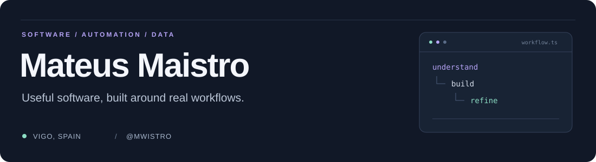
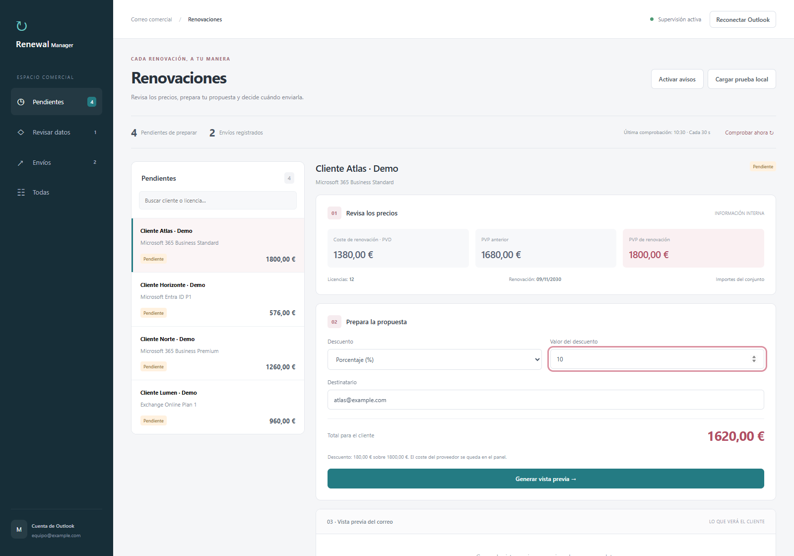
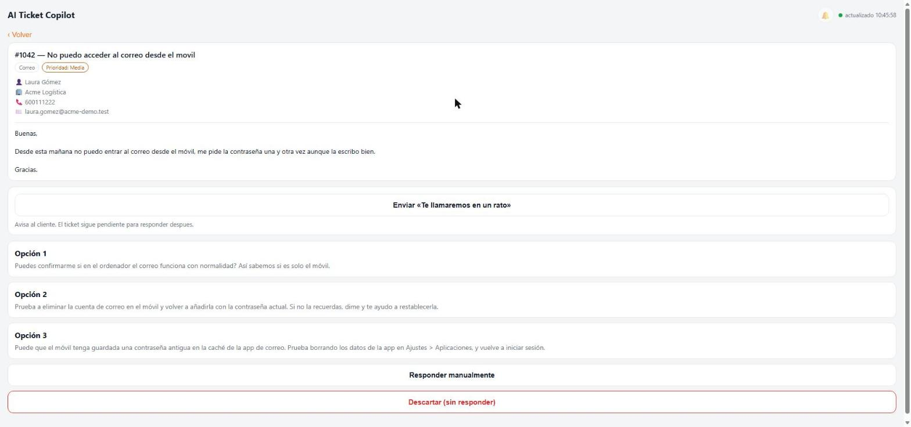

[English](README.md) | **Português (Brasil)** | [Español (España)](README.es-ES.md)

Sou **desenvolvedor full stack** e exploro automação, integração com APIs e análise de dados. Crio ferramentas que organizam tarefas com várias etapas em um fluxo claro.

[LinkedIn](https://linkedin.com/in/mateusmaistro) · [Explorar meus repositórios](https://github.com/mwistro?tab=repositories)

## Projetos em destaque

<table>
<tr>
<td width="50%" valign="top">
<h3><a href="https://github.com/mwistro/renewal-manager">Renewal Manager</a></h3>

De avisos de renovação a propostas revisadas. Um aplicativo desktop para gerenciar a fila, conferir preços e preparar e-mails para clientes com confirmação antes do envio.

Python · Electron · Microsoft Graph

<a href="https://github.com/mwistro/renewal-manager">Capturas, arquitetura e instalação →</a>

</td>
<td width="50%" valign="top">
<h3><a href="https://github.com/mwistro/Supportcandy-AI-copilot">SupportCandy AI Copilot</a></h3>

De tickets de suporte a rascunhos de resposta. Um plugin WordPress e uma PWA em que o agente revisa, edita e envia explicitamente as sugestões.

PHP · WordPress · PWA · OpenAI

<a href="https://github.com/mwistro/Supportcandy-AI-copilot">Capturas, arquitetura e instalação →</a>

</td>
</tr>
</table>

## Mais projetos para explorar

| Projeto | O que explora | Tecnologias |
| --- | --- | --- |
| **[Valorant Stats Bot](https://github.com/mwistro/valorant-bot-dart)** | Perfis de jogadores e estatísticas de partidas recentes no Discord. | Dart · Discord API |
| **[Scrobblez](https://github.com/mwistro/Scrobblez)** | Autenticação no Last.fm e requisições em lotes, com demo offline no terminal. | TypeScript · Node.js |
| **[Pandas Playground](https://github.com/mwistro/pandas-playground)** | Análise de clientes e limpeza de reservas de hotel com gráficos reproduzíveis. | Python · Pandas · Plotly |
| **[SellByQuality](https://github.com/mwistro/SellByQuality)** | Um addon do WoW com filtros por qualidade e confirmação antes das vendas. | Lua · WoW API |

## Ferramentas com que trabalho

| Área | Tecnologias |
| --- | --- |
| Linguagens | Python · JavaScript · TypeScript · PHP · Dart · Lua |
| Aplicações e integrações | Electron · WordPress · REST APIs · Microsoft Graph · Firebase |
| Dados e desenvolvimento | Pandas · Plotly · Jupyter · Git · GitHub Actions |

## O que conecta esses projetos

- **Fluxos úteis:** tornar tarefas repetitivas mais fáceis de acompanhar e executar.
- **Decisões humanas:** manter a revisão e a confirmação visíveis quando uma ação afeta outra pessoa.
- **Projetos legíveis:** explicar como executar o código, mostrar o que ele faz e documentar seus limites.

Ferramentas menores e primeiros exercícios em Python

[JunkBuster](https://github.com/mwistro/JunkBuster) — limpeza de pastas do Windows com uma demonstração isolada.

[Treasure Island](https://github.com/mwistro/mw-treasure-island) · [Band Name Generator](https://github.com/mwistro/mw-band-name-generator) — exercícios iniciais de condições e entrada pelo terminal.

---

A documentação dos projetos está disponível em **inglês, português do Brasil e espanhol da Espanha**.

Outras redes: [Instagram](https://instagram.com/umaistro) · [X](https://twitter.com/constMaistro)
